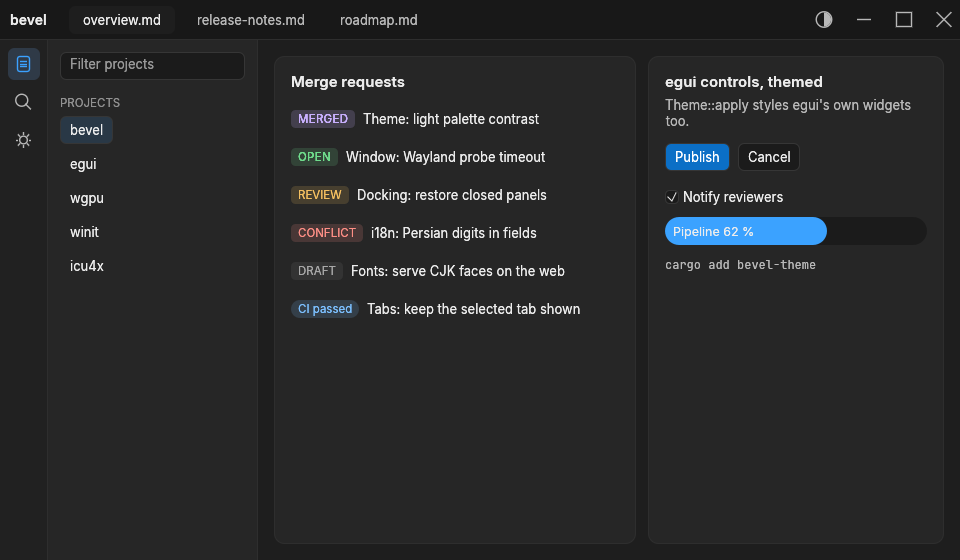

# bevel

[](https://github.com/julien-langlois/bevel/actions/workflows/ci.yml)
[](https://github.com/julien-langlois/bevel/actions/workflows/security.yml)
[](https://crates.io/crates/bevel-theme)
[](https://julien-langlois.github.io/bevel/)
[](https://docs.rs/bevel-widgets)
[](#minimum-supported-rust-version)
[](#license)

A small kit for native-looking desktop apps in Rust with [egui](https://github.com/emilk/egui):
design tokens, reusable controls, window chrome that matches each desktop, and the
translation and font plumbing a multilingual interface needs.

| Crate | What it gives | |
| --- | --- | --- |
| [`bevel-theme`](bevel-theme) | Design tokens in dark and light (surfaces, text, accent, status tones, radii, spacing), applied to an egui context in one call; `Chip` badges; styles for the bevel-widgets buttons; optional embedded Inter and JetBrains Mono. | [](https://crates.io/crates/bevel-theme) [](https://docs.rs/bevel-theme) |
| [`bevel-widgets`](bevel-widgets) | Controls with app-supplied styles: icon buttons, tabs, panes and rails, splits and resize handles, panel docking, a UI font stack with per-script fallback, localized number fields; screenshot tests per language. | [](https://crates.io/crates/bevel-widgets) [](https://docs.rs/bevel-widgets) |
| [`bevel-window`](bevel-window) | Who draws the window frame on each desktop (macOS, Windows, X11, Wayland with or without server-side decorations), the app's own strip as a title bar, edge resizing, and one window per document. | [](https://crates.io/crates/bevel-window) [](https://docs.rs/bevel-window) |
| [`bevel-i18n`](bevel-i18n) | Translation lookup with fallback, CLDR plurals and number formats, the system locale and region, search folding and locale sorting, on ICU4X. | [](https://crates.io/crates/bevel-i18n) [](https://docs.rs/bevel-i18n) |
| [`bevel-fonts-build`](bevel-fonts-build) | `build.rs` helper: embeds font faces (optionally cut to the characters of the app's translations) or serves them to web builds. | [](https://crates.io/crates/bevel-fonts-build) [](https://docs.rs/bevel-fonts-build) |

## Getting started

```toml
[dependencies]
bevel-theme = "0.1"                                     # tokens + bevel-widgets styles
bevel-widgets = "0.1"
bevel-window = { version = "0.1", features = ["egui"] }
```

```rust,ignore
use bevel_theme::{Chip, Theme};

// At startup, or when the user switches between dark and light.
Theme::dark().apply(ctx);

// In the UI.
let theme = Theme::get(ui.ctx());
ui.add(Chip::new("MERGED", theme.tones.purple).strong());
```

```rust,ignore
// Before creating the window: keep the desktop's frame where it draws one, draw our own
// (GNOME on Wayland) where it does not.
let choice = bevel_window::Choice::probe(bevel_window::Prefix::new("MYAPP"));
let viewport = bevel_window::decorate(egui::ViewportBuilder::default(), choice.frame());
```

**[The guide](https://julien-langlois.github.io/bevel/)** explains how the pieces fit, with
screenshots and complete examples (the `bevel-examples` crate:
`cargo run -p bevel-examples --bin gallery`). Each crate's README covers its API in detail, and
the API documentation is on docs.rs.



## Features

| Crate | Feature | Default | Adds |
| --- | --- | --- | --- |
| `bevel-theme` | `widgets` | yes | Styles for bevel-widgets' icon buttons. |
| | `fonts` | | Inter and JetBrains Mono, embedded (about 1.5 MB). |
| `bevel-widgets` | `serde` | | Saving and loading docking layouts. |
| | `native-windows` | | Floating panels in their own OS windows (egui viewports). |
| | `system_fonts` | | Installed fonts for characters the app's faces lack (desktop). |
| | `color_fonts` | | Colour glyphs (COLR, sbix, CBDT), e.g. colour emoji. |
| | `testing` | | A headless driver for docking tests. |
| | `screen-testing` | | Screenshot and input-method tests per language, on egui_kittest (desktop). |
| `bevel-window` | `egui` | | `decorate`, the title bar, edge resizing and `Viewports`. Without it, pure decision logic. |
| `bevel-i18n` | `collate` | | Locale sorting, with ICU4X collation data embedded (about 1 MB). |
| `bevel-fonts-build` | `subset` | | Cutting faces to the app's characters (for `[build-dependencies]` only). |

`bevel-theme`, `bevel-widgets`, `bevel-window` and `bevel-i18n` also build for
`wasm32-unknown-unknown`.

## Minimum supported Rust version

Rust **1.95**, checked in CI. Raising it is a minor version bump while bevel is at 0.x.

## Versioning

The crates are released together, with one version, following [semver](https://semver.org)
(at 0.x, a breaking change bumps the minor version). Changes are listed in
[CHANGELOG.md](CHANGELOG.md); [RELEASING.md](RELEASING.md) describes a release.

## Origin

Most of `bevel-widgets`, `bevel-window`, `bevel-i18n` and `bevel-fonts-build` is forked from
[craft-libs](https://github.com/storytold/craft-libs), adapted to egui from crates.io
(craft-libs builds on a patched egui). [UPSTREAM.md](UPSTREAM.md) lists what changed and how
upstream changes are picked.

## License

Licensed under either of

- Apache License, Version 2.0 ([LICENSE-APACHE](LICENSE-APACHE))
- MIT license ([LICENSE-MIT](LICENSE-MIT))

at your option. [NOTICE](NOTICE) carries the attributions of the forked code.

Two crates also ship material under its own license:

- `bevel-theme`: the Inter and JetBrains Mono fonts, under the
  [SIL Open Font License 1.1](bevel-theme/fonts/Inter-OFL.txt).
- `bevel-i18n`: number, plural and collation data generated from CLDR, under the
  [Unicode License v3](https://www.unicode.org/license.txt).

Unless you explicitly state otherwise, any contribution intentionally submitted for inclusion
in the work by you, as defined in the Apache-2.0 license, shall be dual licensed as above,
without any additional terms or conditions.
