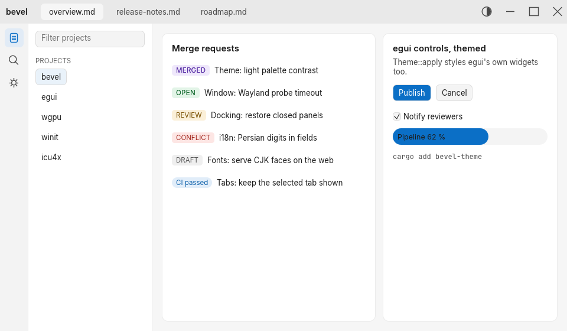

# Getting started

## Add the crates

```toml
[dependencies]
bevel-theme = { version = "0.1", features = ["fonts"] }  # tokens, chips, Inter + JetBrains Mono
bevel-widgets = "0.1"
bevel-window = { version = "0.1", features = ["egui"] }
egui = "0.37"
eframe = "0.37"
```

bevel follows egui's releases: bevel 0.1 is built on egui 0.37. It needs Rust 1.95 or later.

## Open a window

The window's frame is decided before the window exists: [`bevel-window`](window.md) probes
the desktop and says whether the desktop draws the title bar and borders, or the app should.
`decorate` turns that decision into the `ViewportBuilder` settings.

```rust,ignore
{{#include ../../bevel-examples/src/bin/gallery.rs:main}}
```

## Apply the theme

[`Theme::apply`](theme.md) writes the tokens into egui's style (so egui's own buttons,
checkboxes and text fields follow them) and keeps a copy on the context. Apply it once, and
again when the user switches mode; read it back anywhere with `Theme::get`.

```rust,ignore
{{#include ../../bevel-examples/src/lib.rs:theme}}
```

## Draw the screen

From there the screen is ordinary egui, with bevel's pieces where they help: a title bar the
app draws ([Window chrome](window.md)), tabs and icon buttons ([Controls](controls.md)), a
resizable split, chips in the theme's status tones.



## Run the gallery

The complete example is the `bevel-examples` crate in the repository:

```sh
git clone https://github.com/julien-langlois/bevel
cd bevel
cargo run -p bevel-examples --bin gallery
```

`BEVEL_GALLERY_TITLEBAR=app` forces the app-drawn title bar on any desktop,
`BEVEL_GALLERY_TITLEBAR=system` the desktop's.
