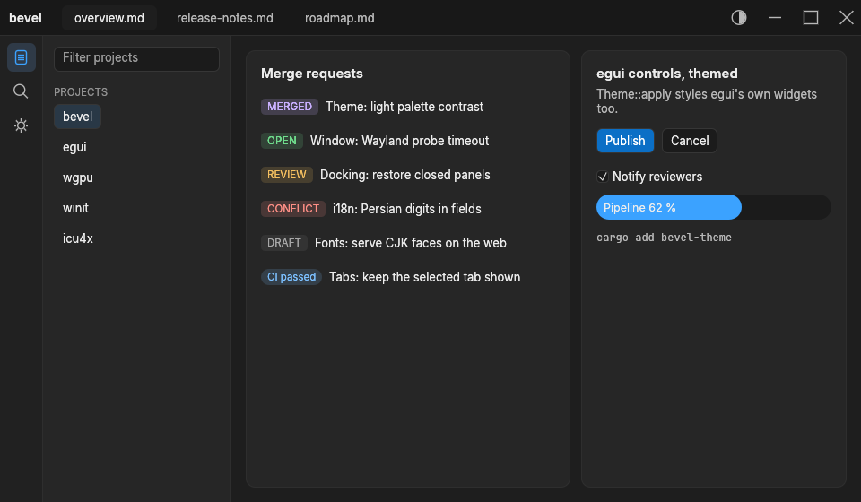

# bevel

**bevel** is a small kit for native-looking desktop apps in Rust with
[egui](https://github.com/emilk/egui). It gives an egui app what egui leaves to each app:
a coherent set of design tokens, a handful of controls that behave like a desktop's, window
chrome that matches the desktop it runs on, and the font and translation plumbing that a
multilingual interface needs.

The gallery from `bevel-examples`, in the dark theme. Every screenshot in this guide is
rendered by a test from the code shown next to it.

## The crates

| Crate | What it gives |
| --- | --- |
| [`bevel-theme`](theme.md) | Design tokens in dark and light (surfaces, text, accent, status tones, radii, spacing), applied to an egui context in one call; `Chip` badges; optional embedded Inter and JetBrains Mono. |
| [`bevel-widgets`](controls.md) | Controls with app-supplied styles: icon buttons, tabs, splits and resize handles, panes, a rail and panel docking, right-to-left helpers, a UI font stack, localized number fields, screenshot tests per language. |
| [`bevel-window`](window.md) | Who draws the window frame on each desktop, the app's own strip as a title bar, edge resizing, and one window per document. |
| [`bevel-i18n`](i18n.md) | Translation lookup with fallback, CLDR plurals and number formats, the system locale and region, search folding and locale sorting. |
| [`bevel-fonts-build`](fonts.md) | A `build.rs` helper that embeds font faces, optionally cut to the characters of the app's translations, or serves them to web builds. |

You can take one crate without the others: `bevel-window` alone fixes the title bar,
`bevel-i18n` alone translates. [How bevel is put together](architecture.md) shows how
they depend on each other.

## What bevel does not do

bevel keeps no application state and runs no commands. Its controls take styles and labels
from the app and give back egui responses or *requests* (move this panel, resize by this much,
open that pane); the app decides what happens. Assets, icons, translations, layouts and
preferences stay in the app. This is what lets an existing egui app adopt one piece at a time.

## Where to go next

- [Getting started](getting-started.md): add the crates and open a themed window.
- The [API documentation](api.md), for every type and function.
- The [repository](https://github.com/julien-langlois/bevel), for issues and the changelog.
